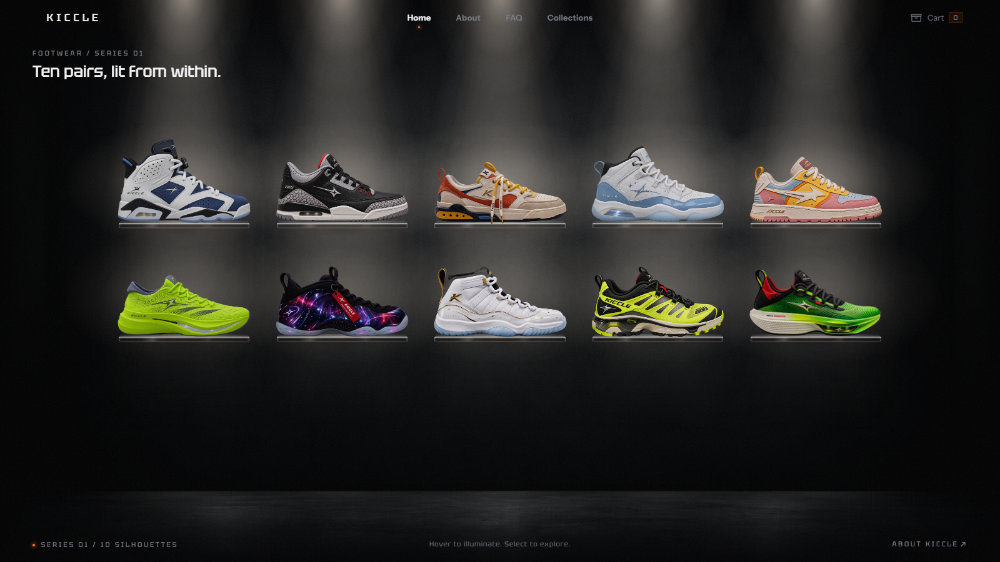

# KICCLE

**A live, interactive web experience — a cinematic sneaker showroom you walk into, not a page you scroll.**

Ten original sneaker concepts stand on lit acrylic plinths in a dark exhibition room. The spotlights come up one column at a time, and selecting a pair sends the camera travelling into the shelf until that single shoe fills the frame.

## Live Demo

### 👉 **[Add Live Website URL]**

## Preview



## About the Project

KICCLE is an independent footwear concept presented as a digital exhibition. It is a design showcase, not a store — nothing is for sale, and no prices appear anywhere in the interface.

The goal was to give a sneaker collection the same treatment a gallery gives its work: a dark room, controlled light, and one object at a time. Visitors arrive in an unlit hall, watch the fixtures strike in sequence, and then choose a pair. Instead of navigating to a separate product page, the camera itself moves — the room stays, the shoe grows, and the details arrive once the move has settled. Stepping back reverses the same movement and returns the room exactly as it was.

Every piece of the experience is built from scratch: the camera rig, the lighting model, the router and the cart are all hand-written, with no framework and no runtime dependencies.

## Inspiration

The starting point was a set of sneaker photographs shared on one of my lecturers' Instagram accounts. Those images were purely the spark — I had no part in them, and they are not presented here as anyone's design work.

Seeing them made me want to design footwear of my own. I began developing original sneaker concepts for KICCLE, and the more the collection grew, the clearer it became that a conventional product grid would not do them justice. That led to this project: a cinematic, interactive web experience built specifically to exhibit those concepts the way they deserve to be seen.

## Features

- **Cinematic opening** — the hall begins dark and five spotlight columns ignite left to right, two sneakers at a time, each lit pair staying lit.
- **True camera movement** — one shared camera rig flies into the selected sneaker. No page reload, no image swap, no second copy of the shoe; the same element simply gets closer, and stays sharp throughout.
- **Lighting model** — beams strike the wall, open downward into soft inverted-V cones, pool behind each pair and bounce faintly off the floor, while the rest of the room stays dark.
- **Product details** — name, category, colourway, description, materials, characteristics and an EU size selector with sold-out states.
- **Demo cart** — thumbnails, quantity controls and a running count, persisted in `localStorage`. It demonstrates the interaction only; there is no checkout.
- **Collections, About and FAQ** — the archive grouped into Court / High-top, Street / Lifestyle and Run / Trail, plus the story behind the project.
- **Responsive by layout, not by cutdown** — a five-column wall on desktop, a panning hall on tablets, and a two-column grid on phones that keeps the exact same camera zoom on tap.
- **Accessibility** — full `prefers-reduced-motion` support (the sequence collapses to a designed static state rather than a broken one), visible focus rings, a skip link, keyboard-navigable menus and 44px touch targets.

## Tech Stack

- **TypeScript** — no framework, no runtime dependencies, no build tooling beyond the compiler.
- **Native ES modules** — the browser loads the compiled modules directly.
- **CSS** — custom properties, Grid, masks and blend modes for the stencilled lighting.
- **Web Animations API** — the camera runs on the compositor.
- **Custom hash router** — `#/`, `#/about`, `#/faq`, `#/collections`, `#/product/<id>`, each directly loadable.
- **`node:test`** — 104 unit tests, no test framework installed.
- **Dependency-free static server** — `scripts/serve.mjs`, written against Node's standard library.
- **Self-hosted fonts** — Tektur and Instrument Sans, under the SIL Open Font License 1.1.

## Getting Started

Requires **Node.js 22 or newer**. There are no dependencies to install.

```sh
git clone https://github.com/BedirhanElcik/KICCLE.git
cd KICCLE
npm run serve
```

Then open **http://127.0.0.1:5173/**. Use `PORT=8080 npm run serve` to change the port.

The compiled `dist/` output is committed, so the site runs straight from a clone — any static file server will do, from any sub-path, since every URL in the HTML, CSS and JS is relative.

If you modify the TypeScript sources, rebuild them:

```sh
npm run build      # src/**/*.ts -> dist/
npm test           # run the unit tests
```

Both require the TypeScript toolchain (`tsc`, `tsx`) to be available on your `PATH`.

## Copyright

**Copyright © 2026 Bedirhan Elçik. All rights reserved.**

The KICCLE source code, brand identity and project materials created by the author are protected by copyright. This project is **not** released under an open-source licence. No permission is granted to copy, redistribute, modify or reuse these materials without written consent.

Third-party components remain subject to their own licences — including the Tektur and Instrument Sans typefaces, distributed under the SIL Open Font License 1.1. No ownership is claimed over any third-party material.

## Contact

- **LinkedIn** — [linkedin.com/in/bedirhanelcik](https://www.linkedin.com/in/bedirhanelcik/)
- **Email** — [bedrhan.elck@outlook.com](mailto:bedrhan.elck@outlook.com)
